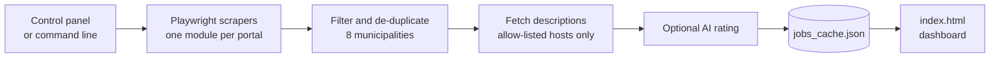

<div align="center">

# Job Scraper Ticino

**Eleven Swiss job portals, one private dashboard.**<br>
Built for cross-border commuters who live in Italy and work in the Mendrisiotto (Ticino).

[](https://github.com/jacknegri89/Job-Scraper-Ticino/actions/workflows/ci.yml)


[](./LICENSE)


<picture>
  <source media="(prefers-color-scheme: dark)" srcset="docs/dashboard-dark.png">
  
</picture>

<sub>The dashboard follows your system theme. Screenshot generated with fictional sample data.</sub>

</div>

## Why this exists

Looking for a job across the border means checking a dozen portals, each with its own filters, and still not knowing the one thing that matters: *what would I actually take home in Italy, and how far is it from my door?*

Job Scraper Ticino collects the listings for you, keeps only the eight municipalities around Chiasso and Mendrisio, removes duplicates, and turns the result into a single searchable page. It runs on your computer. There is no server, no account and no tracking.

## Features

- **One list, eleven portals.** jobs.ch, carriera.ch, Gi Group, Randstad, Orienta, JobScout24, Indeed, Adecco, Manpower, frontaliereticino.ch and LinkedIn, merged and de-duplicated.
- **Eight municipalities.** Chiasso, Mendrisio, Stabio, Balerna, Coldrerio, Morbio Inferiore, Novazzano and Riva San Vitale.
- **Estimated net pay in Italy.** From a monthly gross figure it estimates Swiss social contributions, Ticino withholding tax and any additional Italian income tax, using the cross-border rules in force after 17 July 2023.
- **Distance from home.** A straight-line distance and a small ruler on every listing, from any starting point you choose. Optional.
- **Optional AI rating.** OpenAI can tell you whether a listing fits your profile, estimate the gross salary and write a short summary. Off by default.
- **Local control panel.** Pick municipalities, sources and search terms in the browser instead of editing code.
- **Resilient by design.** If a portal fails or returns nothing, its previous listings stay in the cache and `scan_report.json` tells you what happened. An interrupted scan never overwrites the cache.
- **A dashboard you can trust.** A single `index.html` that loads nothing from the internet, follows your light or dark theme and escapes everything it shows.

## Quick start

You need Python 3.10 or later.

```bash
git clone https://github.com/jacknegri89/Job-Scraper-Ticino.git
cd Job-Scraper-Ticino

python -m venv .venv
# Windows:      .venv\Scripts\activate
# macOS/Linux:  source .venv/bin/activate

python -m pip install -r requirements.txt
python -m playwright install chromium

python main.py
```

`python main.py` opens the local control panel in your browser. Choose what to search, press **Start search**, and the dashboard opens when the search finishes.

On Windows you can double-click `start_panel.bat` instead, which opens the panel without a terminal window.

<details>
<summary><b>Screenshot of the control panel</b></summary>
<br>

</details>

> **Linux note:** Chromium runs with its own sandbox. If the browser reports a sandbox error, configure the host before starting the scraper.

## How it works



1. Each portal has its own module in [`scrapers/`](scrapers) that opens the pages with Chromium and extracts the listings.
2. [`job_filter.py`](job_filter.py) keeps the allowed municipalities, assigns a category and removes duplicates.
3. Descriptions are downloaded only from the expected HTTPS hosts, in a separate browser context with no JavaScript and no saved session. Requests and redirects to any other host are blocked.
4. Descriptions and AI results already in the cache are reused, so you never pay twice for the same listing.
5. [`dashboard_builder.py`](dashboard_builder.py) writes `index.html`.

## Sources

| Source | Notes |
|---|---|
| jobs.ch, carriera.ch, Gi Group, Randstad, Orienta, JobScout24, Adecco, Manpower | Public search pages. |
| Indeed | Public mode only. It does not use the saved session. |
| frontaliereticino.ch | Reads the JSON index the site publishes. |
| LinkedIn | Public pages. Use `--auth linkedin` for a manual login. |
| Monster | Disabled: the portal redirects to monster.com. |

Portals change their pages often, so run `python main.py --dry-run` after installing and every now and then. It checks in a few minutes which sources still respond and writes the outcome to `scan_report.json`. On 2026-11-08 it reached all eleven active portals.

## Command line

The panel covers everyday use. The command line is there for scripts and for debugging.

| Command | What it does |
|---|---|
| `python main.py` | Opens the control panel. |
| `python main.py --background --headless --project-dir` | Runs a search with the saved settings and no panel. |
| `python main.py --scan-only` | Collects listings and writes the report, without descriptions, AI, dashboard or cache changes. |
| `python main.py --dry-run` | Quickly checks access, blocks and selectors for each source. |
| `python main.py --only jobs.ch,indeed` | Limits the search to the given sources and keeps the others in the cache. |
| `python main.py --reanalyze` | Runs the AI only on cached listings that have no result yet, with no new scan. |
| `python main.py --timeout 45000` | Sets the navigation timeout, in milliseconds. |
| `python main.py --auth linkedin` | Opens a manual login and saves the session. |
| `python main.py --panel` | Opens the panel even when other arguments would skip it. |

### Run it every morning (Windows)

`setup_task_scheduler.bat` creates a Windows task that runs a background search at 08:00 with your last saved settings. Run it again to update a task created by an earlier version.

## Configuration

Use the panel (recommended), a `user_config.py` file, or both.

| Setting | Where | Purpose |
|---|---|---|
| Municipalities, sources, search terms | Panel (`user_settings.json`) | What to search. The terms apply to jobs.ch; the other portals use their own strategies. |
| Starting point and coordinates | Panel or `user_config.py` | Used for distances. Without them, distances are not shown. |
| Profile for the AI | Panel or `user_config.py` | Text sent to the model to rate listings. |
| `OPENAI_API_KEY` | Environment variable | Enables the AI rating. It is never typed into the panel or stored on disk. |
| `SCRAPER_HEADLESS`, `SCRAPER_TIMEOUT_MS`, `SCRAPER_ATTEMPTS` | Environment variables | Hidden browser, navigation timeout, attempts per source (at most 3). |

To use `user_config.py`, copy the template (`copy user_config.example.py user_config.py` in PowerShell, `cp user_config.example.py user_config.py` elsewhere) and fill in your coordinates, the name of your starting point and your profile. Coordinates are decimal degrees, for example `45.83` and `9.03`.

Unknown dates stay empty, and relative dates such as "2 days ago" are approximate.

## Privacy and security

- **Everything stays on your machine.** The only data that ever leaves it is what you send to OpenAI if you turn the AI rating on: your profile and the text of the listings.
- **The panel is locked down.** It listens on `127.0.0.1` only, behind a secret address that changes on every start, and checks the origin, a CSRF token and a request limit.
- **The dashboard is inert.** It carries a Content-Security-Policy that blocks every external resource, and all scraped text is escaped.
- **Personal files are never committed.** `user_config.py`, `user_settings.json`, `jobs_cache.json`, `scan_report.json`, `scraper.log`, `debug/`, `profile/` and `index.html` are in `.gitignore` because they can contain your profile, cookies, contact emails and portal content.
- **Be a good guest.** Listings belong to the portals that publish them. Read each source's terms of use before scraping, and do not publish your dashboard or cache without checking what they contain.
- **Estimates are estimates.** The AI's gross figure and the computed net pay are indicative. They are not an offer or personal tax advice. Always check the original listing.

To report a vulnerability, see [SECURITY.md](SECURITY.md).

## Project structure

| Path | Responsibility |
|---|---|
| [`main.py`](main.py) | Commands, scan coordination and cache. |
| [`setup_panel.py`](setup_panel.py), [`setup_panel.html`](setup_panel.html) | The local panel: a `127.0.0.1` server and its page. |
| [`startup_config.py`](startup_config.py) | Reading, validating and saving `user_settings.json`. |
| [`job_filter.py`](job_filter.py) | Municipalities, search terms, categories, normalisation and duplicates. |
| [`distance_calculator.py`](distance_calculator.py) | Straight-line distances. |
| [`salary_calculator.py`](salary_calculator.py) | Indicative net pay from a monthly gross figure. |
| [`ai_analyzer.py`](ai_analyzer.py) | Optional AI rating. |
| [`dashboard_builder.py`](dashboard_builder.py) | Dashboard generation. |
| [`scrapers/`](scrapers) | One module per portal, plus browser setup, sessions, block detection and the scan report. |
| [`tests/`](tests) | Automated tests for filters, dashboard, panel, cache, scrapers and calculations. |

## Development

```bash
python -m pytest -q
python -m ruff check .
```

The tests never contact the portals. They cover filters, the dashboard, the local panel, distances, salary estimates, retries, the cache, pagination, AI validation and URL filtering. They cannot prove that the portals work today: use `python main.py --dry-run` for that. GitHub Actions runs the linter and the tests on Python 3.10 and 3.12.

Contributions are welcome. [CONTRIBUTING.md](CONTRIBUTING.md) explains how to set up, how to add a new source and what a good pull request looks like.

## Known limitations

- Each source depends on the structure of its site. A redesign can empty a portal's results until its module is updated.
- A search started from a panel you have since closed is not recognised by a new panel: wait for it to finish before starting another.
- jobs.ch returns listings for the whole of Ticino, so only a few results fall inside the eight municipalities.

## License

[MIT](LICENSE) © 2026 Giacomo Negri.
