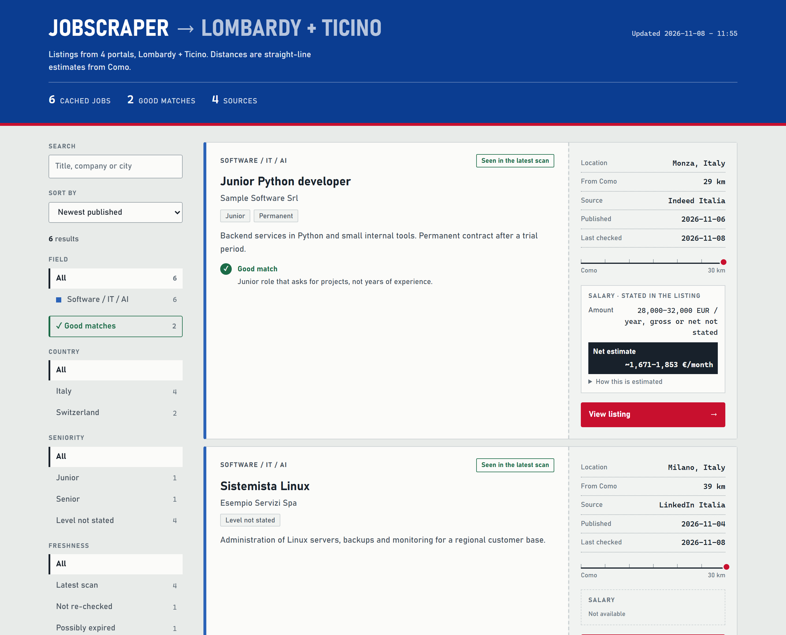
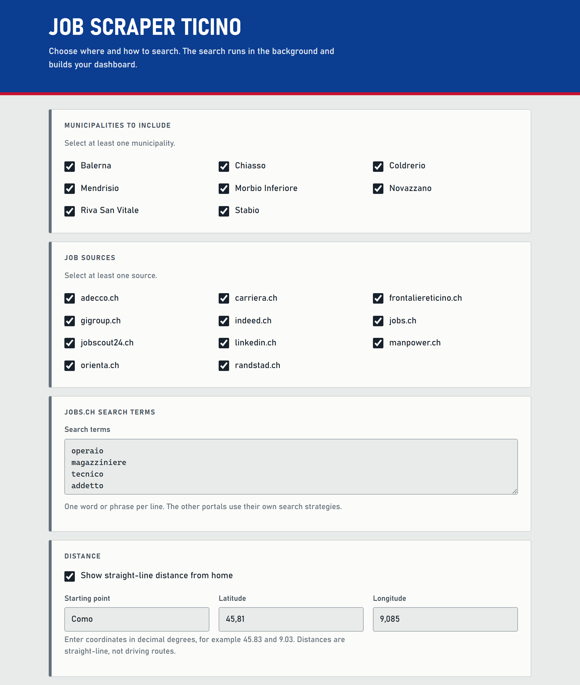

<div align="center">

# JobScraper

**Job listings for Lombardy and Ticino, in one private dashboard.**<br>
Built for people who live in the Milan–Como–Varese area and are willing to work on either side of the border. The focus is software, IT and AI roles; technical trades and other jobs can be shown too.

[](https://github.com/jacknegri89/JobScraper/actions/workflows/ci.yml)


[](./LICENSE)


<picture>
  <source media="(prefers-color-scheme: dark)" srcset="docs/dashboard-dark.png">
  
</picture>

<sub>The dashboard follows your system theme. Screenshot generated with fictional sample data.</sub>

</div>

## Why this exists

Looking for a job across a border means checking a dozen portals, each with its own filters, and still not knowing the things that matter: *how fresh is this listing, is it really near me, and what would I take home?*

JobScraper collects the listings, keeps the ones inside the area you choose (a radius around your town, whole regions, or both), merges the same job found on several portals, and turns the result into a single searchable page. It runs on your computer. There is no server, no account and no tracking.

**Which jobs.** Every listing is sorted into one of three fields: *Software / IT / AI* (developers, system administrators, help desk, data and AI roles), *Technical* (electronics, machining, installation and maintenance) and *Other*. The panel lets you choose the fields you want; the default search terms cover all three, and a setup aimed at IT only is just a matter of ticking one field.

## Features

- **Lombardy and Ticino in one list.** Swiss portals (jobs.ch, carriera.ch, Gi Group, Randstad, Orienta, JobScout24, Indeed, Adecco, Manpower, frontaliereticino.ch, LinkedIn) and Italian ones (Indeed Italia, LinkedIn Italia). See [Sources](#sources) for what was verified and what is not available.
- **Your area, not a fixed list.** Pick Lombardy, Ticino or both, a radius in kilometres (straight line) around your starting point, and any extra towns or provinces. About 2,500 places are known offline.
- **Honest locations.** A listing that only says "Lombardia" is kept apart, marked "location not precise" and given no distance. You decide whether to see it. Fully remote listings are left out unless you ask for them.
- **Fresh or old, always visible.** Every job carries when it was published, when it was first seen and when it was last checked. A portal that is blocked never deletes what you already have: those jobs stay, marked "not re-checked". Jobs missing from a complete scan become "possibly expired", and a few of those pages are opened to see whether they are really gone.
- **The same job, once.** The same job on several portals is merged and keeps a link to each. Two listings on the same portal, or two different companies, are never merged by accident.
- **Seniority and contract, never a silent filter.** Junior, mid-level, senior, manager or not stated, plus the contract type. A "Senior" title is shown unless *you* switch seniors off.
- **A salary you can trust, with its origin.** A pay written in the listing always wins over an estimate. The dashboard says whether the figure is *stated*, *read from the text*, an *AI estimate* or *not available*, shows ranges as ranges, never turns a net figure into a gross one and lists the assumptions behind every net estimate. See [Salary estimates](#salary-estimates).
- **Optional AI rating, off until you switch it on.** OpenAI can rate each listing against your profile. Having `OPENAI_API_KEY` set is not enough to start it: you tick the box in the panel or pass `--ai`. A search rates at most a set number of listings (25 by default), newest first. A result is reused only while the profile, the model, the prompt and the listing are unchanged, so nothing is paid for twice. See [AI rating: cost and limits](#ai-rating-cost-and-limits).
- **Remote and hybrid, read carefully.** "Remoto in Lomazzo" in the location is trusted; so is a clear "100% remoto" or "hybrid" in the description. A denial ("no remote work") or a vague mention ("smart working") leaves the mode unknown.
- **Local control panel.** Choose all of the above in the browser instead of editing code.
- **A report and an exit code you can trust.** Per source: listings read, valid, duplicates, excluded (with the reason) and one of `ok`, `no_results`, `ok_partial`, `blocked`, `selector_broken`… The scan as a whole is `success`, `partial` or `failure`, and the program exits with a matching code. See [Partial and failed scans](#partial-and-failed-scans).
- **A dashboard you can trust.** A single `index.html` that loads nothing from the internet, follows your light or dark theme, escapes everything it shows and runs only its own script.

## Quick start

You need Python 3.10 or later and Git. The steps create a virtual environment named `.venv` inside the project; the Windows batch files below look for it there.

**Windows (PowerShell)**

```powershell
git clone https://github.com/jacknegri89/JobScraper.git
cd JobScraper
python -m venv .venv
.venv\Scripts\python -m pip install -r requirements.txt
.venv\Scripts\python -m playwright install chromium
.venv\Scripts\python main.py
```

**Linux and macOS**

```bash
git clone https://github.com/jacknegri89/JobScraper.git
cd JobScraper
python3 -m venv .venv
.venv/bin/python -m pip install -r requirements.txt
.venv/bin/python -m playwright install chromium
.venv/bin/python main.py
```

(You can also activate the environment first with `.venv\Scripts\activate` or `source .venv/bin/activate` and then type `python` instead of the long path.)

### First start

1. `main.py` opens the **local control panel** in your browser. Nothing has been searched yet.
2. Type your town and press **Find coordinates for this town**, then choose the regions, the radius, the fields, the sources and the search terms. Everything has a sensible default; the panel keeps your choices in `user_settings.json`.
3. Press **Start search**. The search runs in the background (a full search of all sources takes tens of minutes, because the portals are opened politely, one page at a time). The status line tells you whether it finished completely, partially or not at all.
4. When it is done, open `index.html` (the panel's status line says when the dashboard is ready).

On Windows you can double-click `start_panel.bat` instead, which opens the panel without a terminal window.

<details>
<summary><b>Screenshot of the control panel</b></summary>
<br>

</details>

> **Linux note:** Chromium runs with its own sandbox. If the browser reports a sandbox error, configure the host before starting the scraper.

## How it works

```mermaid
flowchart LR
    A["Control panel<br/>or command line"] --> B["Playwright scrapers<br/>one module per portal"]
    B --> C["Normalize<br/>place, seniority, contract"]
    C --> D["Filter and de-duplicate<br/>area, field, level, contract"]
    D --> E["Merge with the cache<br/>first seen, last seen, status"]
    E --> F["Fetch descriptions<br/>allow-listed hosts only"]
    F --> G["Optional AI rating"]
    G --> H[("jobs_cache.json")]
    H --> I["index.html<br/>dashboard"]
```



1. Each portal has its own module in [`scrapers/`](scrapers) that opens the pages with Chromium and extracts the listings.
2. [`job_model.py`](job_model.py) gives every job the same shape: country, region, place and how sure we are of it, seniority, contract, canonical link and every portal link.
3. [`job_pipeline.py`](job_pipeline.py) applies your preferences and counts why each listing was excluded; [`job_dedup.py`](job_dedup.py) merges duplicates across portals in a stable order.
4. [`job_lifecycle.py`](job_lifecycle.py) combines the scan with the cache. [`cache_store.py`](cache_store.py) saves atomically and keeps backups.
5. Descriptions are downloaded only from the expected HTTPS hosts, in a separate browser context with no JavaScript and no saved session. A page that turns out to be an anti-bot message is never stored as a description. At most 60 new pages are opened per run; the rest wait for the next one.
6. [`dashboard_builder.py`](dashboard_builder.py) writes `index.html`.

## Sources

Checked with `python main.py --dry-run --only .` on 2026-11-08, from a normal home connection:

| Source | Country | Status on 2026-11-08 |
|---|---|---|
| jobs.ch, carriera.ch, Gi Group, Randstad, Orienta, JobScout24, Adecco, Manpower | Switzerland | Public search pages: reached. |
| Indeed (`indeed.ch`) | Switzerland | Reached, public mode only. |
| frontaliereticino.ch | Switzerland | Reads the JSON index the site publishes: reached. |
| LinkedIn (`linkedin.ch`) | Switzerland | **Blocked by Cloudflare in that check.** LinkedIn answers intermittently, so a source can work one hour and be blocked the next. A block is reported and never bypassed. |
| Indeed Italia (`indeed.it`) | Italy | Reached; a real scan returned listings with their salary lines. |
| LinkedIn Italia (`linkedin.it`) | Italy | Reached in some runs, blocked in others (same behaviour as above). |
| Monster | Switzerland | Disabled: the portal redirects to monster.com. |
| subito.it | Italy | **Not used.** It answers "Access Denied" to an automated browser. |
| infojobs.it | Italy | **Not used.** It serves an empty page to an automated browser. |
| jobrapido.it, randstad.it, adecco.it | Italy | Reachable but **not implemented yet**: each needs its own page analysis. |

A source that is blocked or empty is shown as such in `scan_report.json` and in the terminal table; coverage is never presented as complete when it is not. CAPTCHAs and login walls are never bypassed.

Portals change their pages often, so run `python main.py --dry-run --only .` after installing and every now and then.

## Salary estimates

Every salary shown on the dashboard says where it comes from:

| Origin | Meaning |
|---|---|
| **Stated in the listing** | The portal gave a salary field (for example Indeed's salary line). |
| **Read from the listing text** | A clear amount with a currency and a period was found in the title or description. |
| **AI estimate** | The model's estimate for your profile, only when the listing writes no salary and the AI is on. |
| **Not available** | Nothing usable. An amount without a period, or with an implausible size, is *not* interpreted. |

A written salary always wins over an AI estimate. Ranges are shown as ranges ("from" and "up to" limits are labelled as limits). Hourly pay is converted with the assumptions listed on the card, and internship allowances get no tax calculation.

From a *gross* amount the dashboard estimates the monthly net pay:

- **Italy (Lombardy):** social contributions, IRPEF brackets and the employee deduction for tax year 2026 ([`italian_tax.py`](italian_tax.py), [`salary_italy.py`](salary_italy.py)), on 13 payments unless the listing states 12 or 14.
- **Ticino:** a simplified model for a *new* cross-border worker living in Italy: Swiss contributions, Ticino withholding tax and the additional Italian tax ([`salary_calculator.py`](salary_calculator.py)).
- **Exchange rate:** the European Central Bank's daily CHF rate, read once a day from `ecb.europa.eu` and shown with its date, or a rate you type in. If the ECB cannot be reached, your typed rate is used.

A *net* amount written in a listing is shown as written; it is never converted to gross.

**Limits you should know.** These are indicative estimates, not payslips and not tax advice. They leave out regional and municipal surcharges, the 2025–2026 payroll tax-cut bonuses, family deductions and collective-agreement extras, and the Swiss rates are simplified assumptions, not official tables. The Italian parameters come from secondary sources and should be checked against the Agenzia delle Entrate before you rely on them. The tests compare the code with hand-worked examples, not with real payslips. Each card lists its assumptions under "How this is estimated".

## AI rating: cost and limits

The AI rating is optional and **off until you switch it on** (the panel's checkbox, or `--ai` / `--reanalyze` on the command line). `OPENAI_API_KEY` in your environment is necessary but never enough on its own.

- **What is sent.** Your profile text and, for each rated listing, its title, company, place and the start of its description, to OpenAI. Listing text goes in as an escaped JSON value and the model is told to treat it as untrusted data. That limits prompt injection but cannot rule it out: a listing could still try to sway the rating, so treat it as a hint.
- **What it costs.** OpenAI bills each request (model `gpt-4o-mini`, one request per listing). The amount depends on OpenAI's current prices and on the listing length, so check your own usage page. To keep the bill predictable, one search rates at most **25 listings** by default (setting "Most listings rated per search", 1 to 200), newest first; the others wait for the next search. Listings that are possibly expired or gone are never sent, and neither are listings your filters hide.
- **Nothing is paid twice.** A rating is stored with a key made of the prompt version, the model, a fingerprint of your profile and the listing text. It is reused while all of these are unchanged and re-done when any of them changes.
- **When the API fails.** Each request has a 10-second timeout and up to 4 attempts with growing waits on rate limits. After 3 failures in a row the run stops asking, and the remaining listings stay pending for the next run. If the credit is exhausted the run says so and stops. A malformed answer is never stored: after the attempts the listing is marked *not analyzable* and retried only with `--reanalyze`.
- **What is checked.** Every answer must be a JSON object with a true/false verdict and plain text; text is shortened; a salary is kept only if its currency matches the country and the amount is plausible.
- The code that talks to OpenAI is covered by tests with a simulated client. It has not been exercised against the real service in this repository's checks, so start with a small cap and look at your usage page.

## Command line

The panel covers everyday use. The command line is there for scripts and for debugging.

| Command | What it does |
|---|---|
| `python main.py` | Opens the control panel. |
| `python main.py --background --headless --project-dir` | Runs a search with the saved settings and no panel. |
| `python main.py --scan-only` | Collects listings and writes the report, without descriptions, AI, dashboard or cache changes. |
| `python main.py --dry-run --only .` | Quickly checks access, blocks and selectors for every source. |
| `python main.py --only jobs.ch,indeed` | Limits the search to the given sources and keeps the others in the cache. |
| `python main.py --ai` | Rates listings with the AI in this run, even if the panel has it switched off. Needs `OPENAI_API_KEY` and costs money. |
| `python main.py --reanalyze` | Runs the AI on cached listings whose analysis is missing or out of date (and retries those it could not analyze), with no new scan. Counts as asking for the AI. |
| `python main.py --timeout 45000` | Sets the navigation timeout, in milliseconds. |
| `python main.py --auth linkedin` | Opens a manual login and saves the session. |
| `python main.py --panel` | Opens the panel even when other arguments would skip it. |

### Exit codes

Every command ends with a code a script or a scheduler can read:

| Code | Meaning |
|---|---|
| `0` | **Success.** Every source that was searched was read to the end. |
| `1` | **Failure.** No source could be read (or the settings or the cache could not be loaded). The cache and the dashboard were left as they were. |
| `2` | **Partial.** Some sources were read and some were not. The dashboard shows what was found plus your saved listings, marked as such. |
| `3` | **Busy.** Another search was already running in this folder, so nothing was changed. |

### Run it every morning

**Windows.** Create the virtual environment first (see [Quick start](#quick-start)), then double-click `setup_task_scheduler.bat`. It creates a task named `JobScraper` that runs `run_scheduled.bat` every day at 08:00 with your last saved settings. That file uses the Python of `.venv`, appends everything to `scraper.log` and passes the exit code on, so Task Scheduler's "Last Run Result" shows `0`, `2` and so on. Run the setup file again after moving the folder; it also replaces a task created by an earlier version. Remove the task with `schtasks /delete /tn "JobScraper"`.

**Linux and macOS.** Use the environment's Python in a cron entry, for example at 08:00:

```bash
0 8 * * * cd /path/to/JobScraper && .venv/bin/python main.py --background --headless --project-dir >> scraper.log 2>&1
```

If a scheduled search starts while another one (or the panel's search) is still running, it exits with code `3` instead of writing to the same files.

## Partial and failed scans

Portals block, time out and change their pages, so a scan can end in three ways. The terminal table and `scan_report.json` say which, source by source:

| Status | Meaning | Effect on saved jobs |
|---|---|---|
| `ok` | The source was searched to the end and returned listings. | Saved jobs that were not returned become *possibly expired*. |
| `no_results` | The source answered and says nothing matches. | Same: a complete answer, so missing jobs can expire. |
| `ok_partial` | Listings were read, but a page failed, was blocked or could not be understood. | Nothing expires: missing jobs stay and are marked *not re-checked*. |
| `blocked`, `requires_auth`, `timeout`, `network_error`, `selector_broken`, `error`, `empty` | Nothing trustworthy was read from this source. | Nothing expires. |

The scan as a whole is `success` when every searched source is `ok` or `no_results`, `partial` when at least one was read and not all, and `failure` when none was. If the scan is a `failure`, `jobs_cache.json` and `index.html` are not touched, so a previous good dashboard is never replaced by an empty one.

## How the cache works

`jobs_cache.json` is the memory of the project: every listing you have collected, with when it was first seen, last seen and last checked, its status and any description or AI rating already obtained.

- Each scan is merged into it: a returned listing becomes *active*; a missing one is never deleted by a single scan.
- A listing unseen for longer than the *expiry* you set (14 days by default) becomes *possibly expired*, and a few such pages are opened to see whether they are really gone. Listings unseen for longer than the *retention* (60 days by default) are forgotten.
- Listings that pass your area and field filters at scan time are stored. Seniority, contract and remote work can only be settled once the description is read, so they are checked again when the dashboard is built: a stored listing can be hidden by them without being deleted, and shown again if you change the filter.
- Every save writes a temporary file and replaces the cache in one step. The cache left by the previous run is kept as `jobs_cache.json.bak`; a cache written by an older version is also kept once as `jobs_cache.json.pre-v2.bak`.
- A cache file that cannot be read stops the run instead of being overwritten.

## Configuration

Use the panel (recommended), a `user_config.py` file, or both.

| Setting | Where | Purpose |
|---|---|---|
| Regions, radius, extra places, uncertain and remote listings | Panel (`user_settings.json`) | Where to look. |
| Field, seniority, contract | Panel | What kind of job you want. |
| Sources, search terms | Panel | What to search. The terms are used by the portals that take a search term. |
| Starting point and coordinates | Panel (it can look a town up) or `user_config.py` | Used for the radius and for distances. Without them distances are not shown. |
| Profile for the AI | Panel or `user_config.py` | Text sent to the model to rate listings. |
| Expiry, retention, pages to re-check | Panel | How long an unseen listing is trusted, when it is forgotten, and how many "possibly expired" pages are opened per search. |
| Exchange rate | Panel | ECB daily rate or your own. |
| `OPENAI_API_KEY` | Environment variable | Enables the AI rating. It is never typed into the panel or stored on disk. |
| `SCRAPER_HEADLESS`, `SCRAPER_TIMEOUT_MS`, `SCRAPER_ATTEMPTS` | Environment variables | Hidden browser, navigation timeout, attempts per source (at most 3). |

There is no default starting point: your town is never part of the code. Settings saved by an earlier version (a list of Ticino municipalities) are migrated automatically and the old file is kept next to the new one as `user_settings.json.v1.bak`.

To use `user_config.py`, copy the template (`copy user_config.example.py user_config.py` in PowerShell, `cp user_config.example.py user_config.py` elsewhere) and fill in your coordinates, the name of your starting point and your profile. Coordinates are decimal degrees, for example `45.65` and `9.13`.

Unknown dates stay empty, and relative dates such as "2 days ago" are approximate.

## Privacy and security

- **Everything stays on your machine.** The data that can leave it: the search terms and the name of your starting town, which go to the portals inside their search requests (that is how a portal can search near you; the coordinates are never sent); what you send to OpenAI if you turn the AI rating on (your profile and the text of the listings); and one request a day to `ecb.europa.eu` for the exchange rate if you use the ECB mode. There is no telemetry.
- **The panel is locked down.** It listens on `127.0.0.1` only, behind a secret address that changes on every start, and checks the Host and Origin headers, a CSRF token and a request limit. Its page script runs only with a one-time nonce, and a second search is refused while one is running.
- **The dashboard is inert.** Its Content-Security-Policy blocks every external resource and allows no script except the page's own (identified by its hash, not by `unsafe-inline`). All scraped text is escaped and only `http` and `https` links are clickable.
- **Outgoing requests are limited.** Listing descriptions are fetched only from the allowed portal hosts over HTTPS (no other host, port or credentials, redirects included), in a browser context with JavaScript off and no saved session. Downloads from other sources have a size limit.
- **Listing text is data, not instructions.** It reaches the AI only as an escaped JSON value, and every AI answer is validated strictly before it is used.
- **Personal files are never committed.** `user_config.py`, `user_settings.json`, `jobs_cache.json`, their backups, `fx_cache.json`, `scan_report.json`, `scraper.log`, `debug/`, `profile/` and `index.html` are in `.gitignore` because they can contain your profile, home town, cookies, contact emails and portal content.
- **Be a good guest.** Listings belong to the portals that publish them. Read each source's terms of use before scraping, and do not publish your dashboard or cache without checking what they contain. The scrapers never solve captchas or log in on your behalf unless you run `--auth` yourself.

To report a vulnerability, see [SECURITY.md](SECURITY.md).

## Project structure

| Path | Responsibility |
|---|---|
| [`main.py`](main.py), [`dry_run.py`](dry_run.py) | Commands and scan coordination; the quick portal check. |
| [`exit_codes.py`](exit_codes.py), [`run_lock.py`](run_lock.py) | The exit codes and the one-scan-at-a-time lock. |
| [`setup_panel.py`](setup_panel.py), [`setup_panel.html`](setup_panel.html) | The local panel: a `127.0.0.1` server and its page. |
| [`startup_config.py`](startup_config.py), [`preferences.py`](preferences.py) | Reading, validating, migrating and saving `user_settings.json`; what the user wants. |
| [`geo.py`](geo.py), `data/places.json` | Places in Lombardy and Ticino, location certainty and the search area. Data: GeoNames (CC BY 4.0), built by `tools/build_places.py`. |
| [`job_model.py`](job_model.py), [`job_classifier.py`](job_classifier.py), [`work_mode.py`](work_mode.py), [`job_filter.py`](job_filter.py) | One shape for every job; seniority, contract, remote/hybrid and field. |
| [`job_pipeline.py`](job_pipeline.py), [`job_dedup.py`](job_dedup.py) | Filtering with reasons and de-duplication. |
| [`job_lifecycle.py`](job_lifecycle.py), [`job_status.py`](job_status.py), [`cache_store.py`](cache_store.py) | Freshness, expiry and safe cache storage. |
| [`salary_extractor.py`](salary_extractor.py), [`salary_resolver.py`](salary_resolver.py) | Reading written salaries and choosing which one to show. |
| [`italian_tax.py`](italian_tax.py), [`salary_italy.py`](salary_italy.py), [`salary_calculator.py`](salary_calculator.py), [`fx_rates.py`](fx_rates.py) | Tax rules, net pay estimates and the exchange rate. |
| [`distance_calculator.py`](distance_calculator.py) | Straight-line distances. |
| [`ai_analyzer.py`](ai_analyzer.py) | Optional AI rating and its cache keys. |
| [`dashboard_builder.py`](dashboard_builder.py), [`dashboard_template/`](dashboard_template) | Dashboard generation; the page, its CSS and its script, joined into one `index.html`. |
| [`scrapers/`](scrapers) | One module per portal, plus browser setup, sessions, block detection and the scan report. |
| [`tests/`](tests) | Automated tests. |

## Development

```bash
python -m pip install -r requirements-dev.txt   # runtime dependencies plus pytest and ruff
python -m pytest -q
python -m ruff check .
```

`requirements.txt` pins the versions the tests run against and `requirements-dev.txt` adds the tools. Ruff checks for errors, likely bugs and the security rules of bandit.

The tests never contact the portals and need no browser. They cover places and locations, filtering and exclusion reasons (also after the description is read), de-duplication, freshness and the cache, scan completeness and exit codes, the one-scan lock, salary reading and estimates, the exchange rate, settings and their migration, the AI cache (keys, limits, invalidation, malformed answers, outages), the panel, the dashboard, security (hostile markup, the CSP, allowed hosts, injection), retries, page loops and the report. Scrapers are tested with simulated pages, so they prove the logic around the portals, not that a portal's markup is unchanged: use `python main.py --dry-run --only .` for that.

GitHub Actions runs the linter and the tests on Python 3.10 and 3.12 (Ubuntu) and 3.12 (Windows), and a separate job audits the pinned dependencies for known vulnerabilities. Dependabot proposes updates weekly.

Contributions are welcome. [CONTRIBUTING.md](CONTRIBUTING.md) explains how to set up, how to add a new source and what a good pull request looks like.

## Known limitations

- Each source depends on the structure of its site. A redesign can empty a portal's results until its module is updated.
- LinkedIn and some other portals block repeated automated requests. Run searches a few hours apart and read the status column.
- Some portals show the salary only on the detail page or not at all; then the salary is "not available" unless the AI is on.
- Only listings with a place that can be matched to Lombardy or Ticino are placed on the map of distances. Places outside those two regions are not known.
- Only one search runs at a time per folder. A second one (another panel, the command line or a scheduled task) stops with exit code `3`. If a run was killed, its lock is recognised as stale and replaced automatically.
- Distances are straight-line estimates. The portals' own "near me" radius can differ, and a portal may ignore the radius for some searches.
- The tax and salary figures are estimates (see [Salary estimates](#salary-estimates)).

## License

[MIT](LICENSE) © 2026 Giacomo Negri. Place data © GeoNames, [CC BY 4.0](https://creativecommons.org/licenses/by/4.0/).
