<div align="center">

# JobScraper

**Software and IT jobs in Lombardy and Ticino, in one private dashboard.**<br>
Built for people who live in the Milan–Como–Varese area and are willing to work on either side of the border.

[](https://github.com/jacknegri89/JobScraper/actions/workflows/ci.yml)


[](./LICENSE)


<picture>
  <source media="(prefers-color-scheme: dark)" srcset="docs/dashboard-dark.png">
  
</picture>

<sub>The dashboard follows your system theme. Screenshot generated with fictional sample data.</sub>

</div>

## Why this exists

Looking for a job across a border means checking a dozen portals, each with its own filters, and still not knowing the things that matter: *how fresh is this listing, is it really near me, and what would I take home?*

JobScraper collects the listings, keeps the ones inside the area you choose (a radius around your town, whole regions, or both), merges the same job found on several portals, and turns the result into a single searchable page. It runs on your computer. There is no server, no account and no tracking.

## Features

- **Lombardy and Ticino in one list.** Swiss portals (jobs.ch, carriera.ch, Gi Group, Randstad, Orienta, JobScout24, Indeed, Adecco, Manpower, frontaliereticino.ch, LinkedIn) and Italian ones (Indeed Italia, LinkedIn Italia). See [Sources](#sources) for what was verified and what is not available.
- **Your area, not a fixed list.** Pick Lombardy, Ticino or both, a radius in kilometres (straight line) around your starting point, and any extra towns or provinces. About 2,500 places are known offline.
- **Honest locations.** A listing that only says "Lombardia" is kept apart, marked "location not precise" and given no distance. You decide whether to see it. Fully remote listings are left out unless you ask for them.
- **Fresh or old, always visible.** Every job carries when it was published, when it was first seen and when it was last checked. A portal that is blocked never deletes what you already have: those jobs stay, marked "not re-checked". Jobs missing from a complete scan become "possibly expired", and a few of those pages are opened to see whether they are really gone.
- **The same job, once.** The same job on several portals is merged and keeps a link to each. Two listings on the same portal, or two different companies, are never merged by accident.
- **Seniority and contract, never a silent filter.** Junior, mid-level, senior, manager or not stated, plus the contract type. A "Senior" title is shown unless *you* switch seniors off.
- **A salary you can trust, with its origin.** A pay written in the listing always wins over an estimate. The dashboard says whether the figure is *stated*, *read from the text*, an *AI estimate* or *not available*, shows ranges as ranges, never turns a net figure into a gross one and lists the assumptions behind every net estimate. See [Salary estimates](#salary-estimates).
- **Optional AI rating.** OpenAI can rate each listing against your profile. A result is reused only while the profile, the model, the prompt and the listing are unchanged, so changing your profile re-rates the listings and nothing is paid for twice. Off by default.
- **Local control panel.** Choose all of the above in the browser instead of editing code.
- **A report you can read.** Per source: listings read, valid, duplicates, excluded (with the reason) and one of `ok`, `no_results`, `ok_partial`, `blocked`, `selector_broken`… The scan as a whole is `success`, `partial` or `failure` by explicit rules.
- **A dashboard you can trust.** A single `index.html` that loads nothing from the internet, follows your light or dark theme and escapes everything it shows.

## Quick start

You need Python 3.10 or later.

```bash
git clone https://github.com/jacknegri89/JobScraper.git
cd JobScraper

python -m venv .venv
# Windows:      .venv\Scripts\activate
# macOS/Linux:  source .venv/bin/activate

python -m pip install -r requirements.txt
python -m playwright install chromium

python main.py
```

`python main.py` opens the local control panel in your browser. Choose what to search, press **Start search**, and the dashboard opens when the search finishes.

On Windows you can double-click `start_panel.bat` instead, which opens the panel without a terminal window.

<details>
<summary><b>Screenshot of the control panel</b></summary>
<br>

</details>

> **Linux note:** Chromium runs with its own sandbox. If the browser reports a sandbox error, configure the host before starting the scraper.

## How it works

```mermaid
flowchart LR
    A["Control panel<br/>or command line"] --> B["Playwright scrapers<br/>one module per portal"]
    B --> C["Normalize<br/>place, seniority, contract"]
    C --> D["Filter and de-duplicate<br/>area, field, level, contract"]
    D --> E["Merge with the cache<br/>first seen, last seen, status"]
    E --> F["Fetch descriptions<br/>allow-listed hosts only"]
    F --> G["Optional AI rating"]
    G --> H[("jobs_cache.json")]
    H --> I["index.html<br/>dashboard"]
```



1. Each portal has its own module in [`scrapers/`](scrapers) that opens the pages with Chromium and extracts the listings.
2. [`job_model.py`](job_model.py) gives every job the same shape: country, region, place and how sure we are of it, seniority, contract, canonical link and every portal link.
3. [`job_pipeline.py`](job_pipeline.py) applies your preferences and counts why each listing was excluded; [`job_dedup.py`](job_dedup.py) merges duplicates across portals in a stable order.
4. [`job_lifecycle.py`](job_lifecycle.py) combines the scan with the cache. [`cache_store.py`](cache_store.py) saves atomically and keeps backups.
5. Descriptions are downloaded only from the expected HTTPS hosts, in a separate browser context with no JavaScript and no saved session. A page that turns out to be an anti-bot message is never stored as a description. At most 60 new pages are opened per run; the rest wait for the next one.
6. [`dashboard_builder.py`](dashboard_builder.py) writes `index.html`.

## Sources

Checked with `python main.py --dry-run --only .` on 2026-11-08, from a normal home connection:

| Source | Country | Status on 2026-11-08 |
|---|---|---|
| jobs.ch, carriera.ch, Gi Group, Randstad, Orienta, JobScout24, Adecco, Manpower | Switzerland | Public search pages: reached. |
| Indeed (`indeed.ch`) | Switzerland | Reached, public mode only. |
| frontaliereticino.ch | Switzerland | Reads the JSON index the site publishes: reached. |
| LinkedIn (`linkedin.ch`) | Switzerland | **Blocked by Cloudflare in that check.** LinkedIn answers intermittently, so a source can work one hour and be blocked the next. A block is reported and never bypassed. |
| Indeed Italia (`indeed.it`) | Italy | Reached; a real scan returned listings with their salary lines. |
| LinkedIn Italia (`linkedin.it`) | Italy | Reached in some runs, blocked in others (same behaviour as above). |
| Monster | Switzerland | Disabled: the portal redirects to monster.com. |
| subito.it | Italy | **Not used.** It answers "Access Denied" to an automated browser. |
| infojobs.it | Italy | **Not used.** It serves an empty page to an automated browser. |
| jobrapido.it, randstad.it, adecco.it | Italy | Reachable but **not implemented yet**: each needs its own page analysis. |

A source that is blocked or empty is shown as such in `scan_report.json` and in the terminal table; coverage is never presented as complete when it is not. CAPTCHAs and login walls are never bypassed.

Portals change their pages often, so run `python main.py --dry-run --only .` after installing and every now and then.

## Salary estimates

Every salary shown on the dashboard says where it comes from:

| Origin | Meaning |
|---|---|
| **Stated in the listing** | The portal gave a salary field (for example Indeed's salary line). |
| **Read from the listing text** | A clear amount with a currency and a period was found in the title or description. |
| **AI estimate** | The model's estimate for your profile, only when the listing writes no salary and the AI is on. |
| **Not available** | Nothing usable. An amount without a period, or with an implausible size, is *not* interpreted. |

A written salary always wins over an AI estimate. Ranges are shown as ranges ("from" and "up to" limits are labelled as limits). Hourly pay is converted with the assumptions listed on the card, and internship allowances get no tax calculation.

From a *gross* amount the dashboard estimates the monthly net pay:

- **Italy (Lombardy):** social contributions, IRPEF brackets and the employee deduction for tax year 2026 ([`italian_tax.py`](italian_tax.py), [`salary_italy.py`](salary_italy.py)), on 13 payments unless the listing states 12 or 14.
- **Ticino:** a simplified model for a *new* cross-border worker living in Italy: Swiss contributions, Ticino withholding tax and the additional Italian tax ([`salary_calculator.py`](salary_calculator.py)).
- **Exchange rate:** the European Central Bank's daily CHF rate, read once a day from `ecb.europa.eu` and shown with its date, or a rate you type in. If the ECB cannot be reached, your typed rate is used.

A *net* amount written in a listing is shown as written; it is never converted to gross.

**Limits you should know.** These are indicative estimates, not payslips and not tax advice. They leave out regional and municipal surcharges, the 2025–2026 payroll tax-cut bonuses, family deductions and collective-agreement extras, and the Swiss rates are simplified assumptions, not official tables. The Italian parameters come from secondary sources and should be checked against the Agenzia delle Entrate before you rely on them. The tests compare the code with hand-worked examples, not with real payslips. Each card lists its assumptions under "How this is estimated".

## Command line

The panel covers everyday use. The command line is there for scripts and for debugging.

| Command | What it does |
|---|---|
| `python main.py` | Opens the control panel. |
| `python main.py --background --headless --project-dir` | Runs a search with the saved settings and no panel. |
| `python main.py --scan-only` | Collects listings and writes the report, without descriptions, AI, dashboard or cache changes. |
| `python main.py --dry-run --only .` | Quickly checks access, blocks and selectors for every source. |
| `python main.py --only jobs.ch,indeed` | Limits the search to the given sources and keeps the others in the cache. |
| `python main.py --reanalyze` | Runs the AI on cached listings whose analysis is missing or out of date (and retries those it could not analyze), with no new scan. |
| `python main.py --timeout 45000` | Sets the navigation timeout, in milliseconds. |
| `python main.py --auth linkedin` | Opens a manual login and saves the session. |
| `python main.py --panel` | Opens the panel even when other arguments would skip it. |

### Run it every morning (Windows)

`setup_task_scheduler.bat` creates a Windows task that runs a background search at 08:00 with your last saved settings. Run it again to update a task created by an earlier version.

## Configuration

Use the panel (recommended), a `user_config.py` file, or both.

| Setting | Where | Purpose |
|---|---|---|
| Regions, radius, extra places, uncertain and remote listings | Panel (`user_settings.json`) | Where to look. |
| Field, seniority, contract | Panel | What kind of job you want. |
| Sources, search terms | Panel | What to search. The terms are used by the portals that take a search term. |
| Starting point and coordinates | Panel (it can look a town up) or `user_config.py` | Used for the radius and for distances. Without them distances are not shown. |
| Profile for the AI | Panel or `user_config.py` | Text sent to the model to rate listings. |
| Expiry, retention, pages to re-check | Panel | How long an unseen listing is trusted, when it is forgotten, and how many "possibly expired" pages are opened per search. |
| Exchange rate | Panel | ECB daily rate or your own. |
| `OPENAI_API_KEY` | Environment variable | Enables the AI rating. It is never typed into the panel or stored on disk. |
| `SCRAPER_HEADLESS`, `SCRAPER_TIMEOUT_MS`, `SCRAPER_ATTEMPTS` | Environment variables | Hidden browser, navigation timeout, attempts per source (at most 3). |

There is no default starting point: your town is never part of the code. Settings saved by an earlier version (a list of Ticino municipalities) are migrated automatically and the old file is kept next to the new one as `user_settings.json.v1.bak`.

To use `user_config.py`, copy the template (`copy user_config.example.py user_config.py` in PowerShell, `cp user_config.example.py user_config.py` elsewhere) and fill in your coordinates, the name of your starting point and your profile. Coordinates are decimal degrees, for example `45.65` and `9.13`.

Unknown dates stay empty, and relative dates such as "2 days ago" are approximate.

## Privacy and security

- **Everything stays on your machine.** The data that can leave it: what you send to OpenAI if you turn the AI rating on (your profile and the text of the listings), and one request a day to `ecb.europa.eu` for the exchange rate if you use the ECB mode. There is no telemetry.
- **The panel is locked down.** It listens on `127.0.0.1` only, behind a secret address that changes on every start, and checks the origin, a CSRF token and a request limit.
- **The dashboard is inert.** It carries a Content-Security-Policy that blocks every external resource, and all scraped text is escaped.
- **Listing text is data, not instructions.** It reaches the AI only as an escaped JSON value, and every AI answer is validated strictly before it is used.
- **Personal files are never committed.** `user_config.py`, `user_settings.json`, `jobs_cache.json`, their backups, `fx_cache.json`, `scan_report.json`, `scraper.log`, `debug/`, `profile/` and `index.html` are in `.gitignore` because they can contain your profile, home town, cookies, contact emails and portal content.
- **Be a good guest.** Listings belong to the portals that publish them. Read each source's terms of use before scraping, and do not publish your dashboard or cache without checking what they contain. The scrapers never solve captchas or log in on your behalf unless you run `--auth` yourself.

To report a vulnerability, see [SECURITY.md](SECURITY.md).

## Project structure

| Path | Responsibility |
|---|---|
| [`main.py`](main.py) | Commands and scan coordination. |
| [`setup_panel.py`](setup_panel.py), [`setup_panel.html`](setup_panel.html) | The local panel: a `127.0.0.1` server and its page. |
| [`startup_config.py`](startup_config.py), [`preferences.py`](preferences.py) | Reading, validating, migrating and saving `user_settings.json`; what the user wants. |
| [`geo.py`](geo.py), `data/places.json` | Places in Lombardy and Ticino, location certainty and the search area. Data: GeoNames (CC BY 4.0), built by `tools/build_places.py`. |
| [`job_model.py`](job_model.py), [`job_classifier.py`](job_classifier.py), [`job_filter.py`](job_filter.py) | One shape for every job; seniority, contract and field. |
| [`job_pipeline.py`](job_pipeline.py), [`job_dedup.py`](job_dedup.py) | Filtering with reasons and de-duplication. |
| [`job_lifecycle.py`](job_lifecycle.py), [`job_status.py`](job_status.py), [`cache_store.py`](cache_store.py) | Freshness, expiry and safe cache storage. |
| [`salary_extractor.py`](salary_extractor.py), [`salary_resolver.py`](salary_resolver.py) | Reading written salaries and choosing which one to show. |
| [`italian_tax.py`](italian_tax.py), [`salary_italy.py`](salary_italy.py), [`salary_calculator.py`](salary_calculator.py), [`fx_rates.py`](fx_rates.py) | Tax rules, net pay estimates and the exchange rate. |
| [`distance_calculator.py`](distance_calculator.py) | Straight-line distances. |
| [`ai_analyzer.py`](ai_analyzer.py) | Optional AI rating and its cache keys. |
| [`dashboard_builder.py`](dashboard_builder.py) | Dashboard generation. |
| [`scrapers/`](scrapers) | One module per portal, plus browser setup, sessions, block detection and the scan report. |
| [`tests/`](tests) | Automated tests. |

## Development

```bash
python -m pytest -q
python -m ruff check .
```

The tests never contact the portals. They cover places and locations, filtering and exclusion reasons, de-duplication, freshness and the cache, salary reading and estimates, the exchange rate, settings and their migration, the AI cache (keys, invalidation, malformed answers, outages), the panel, the dashboard, retries and the report. They cannot prove that the portals work today: use `python main.py --dry-run --only .` for that. GitHub Actions runs the linter and the tests on Python 3.10 and 3.12.

Contributions are welcome. [CONTRIBUTING.md](CONTRIBUTING.md) explains how to set up, how to add a new source and what a good pull request looks like.

## Known limitations

- Each source depends on the structure of its site. A redesign can empty a portal's results until its module is updated.
- LinkedIn and some other portals block repeated automated requests. Run searches a few hours apart and read the status column.
- Some portals show the salary only on the detail page or not at all; then the salary is "not available" unless the AI is on.
- Only listings with a place that can be matched to Lombardy or Ticino are placed on the map of distances. Places outside those two regions are not known.
- A search started from a panel you have since closed is not recognised by a new panel: wait for it to finish before starting another.

## License

[MIT](LICENSE) © 2026 Giacomo Negri. Place data © GeoNames, [CC BY 4.0](https://creativecommons.org/licenses/by/4.0/).
