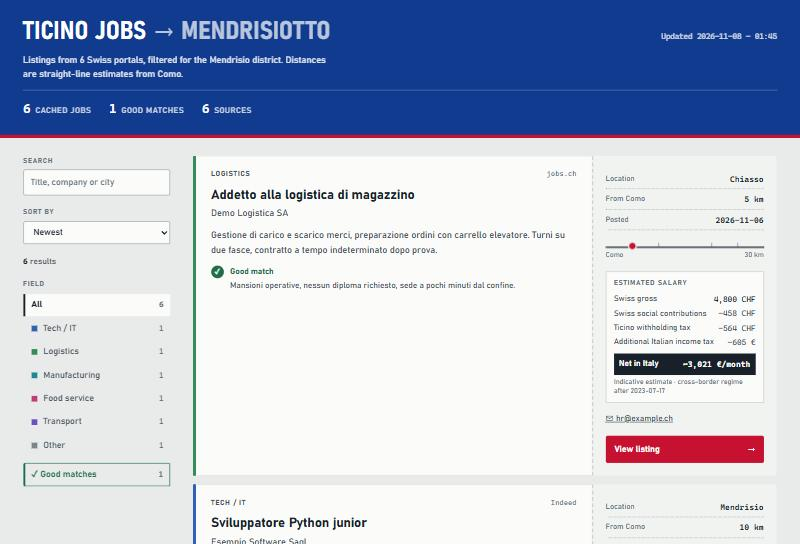

# Job Scraper Ticino

[](https://github.com/jacknegri89/Job-Scraper-Ticino/actions/workflows/ci.yml)

[](./LICENSE)

Raccoglie gli annunci di lavoro di dodici portali svizzeri, tiene solo quelli nei comuni del Mendrisiotto e li mostra in una dashboard HTML con ricerca, filtri, distanza da casa e stima dello stipendio netto per chi vive in Italia e lavora in Ticino (frontalieri). Gira in locale: nessun server, nessun account da creare.



*Dashboard generata con dati di esempio.*

## Cosa offre

- **Dodici fonti** in un'unica lista, senza duplicati tra portali.
- **Otto comuni**: Chiasso, Mendrisio, Stabio, Balerna, Coldrerio, Morbio Inferiore, Novazzano e Riva San Vitale.
- **Dashboard** con ricerca, ordinamento per data o distanza, filtro per categoria e tema chiaro o scuro in base al sistema. È un unico file `index.html` che non carica nulla da Internet.
- **Distanza in linea d'aria** da una località di partenza a scelta (facoltativa).
- **Stima del netto in Italia** a partire dal lordo mensile, con i contributi svizzeri, l'imposta alla fonte ticinese e l'eventuale imposta italiana aggiuntiva.
- **Analisi AI facoltativa** (OpenAI): dice se l'annuncio è adatto al tuo profilo e ne ricava lordo stimato e riassunto.
- **Pannello di configurazione locale** nel browser, per scegliere comuni, fonti e parole di ricerca senza toccare il codice.
- **Cache e report**: se un portale fallisce, gli annunci precedenti restano e `scan_report.json` spiega cosa è andato storto.

## Fonti

| Fonte | Note |
|---|---|
| jobs.ch, carriera.ch, Gi Group, Randstad, Orienta, JobScout24, Adecco, Manpower | Ricerca sulle pagine pubbliche. |
| Indeed | Solo modalità pubblica; non usa la sessione salvata. |
| frontaliereticino.ch | Legge l'indice JSON pubblicato dal sito. |
| LinkedIn | Pagine pubbliche; per il login manuale usa `--auth linkedin`. |
| Monster | Disattivato: il portale reindirizza a monster.com. |

I portali cambiano spesso. Dopo l'installazione, e ogni tanto in seguito, esegui `python main.py --dry-run`: controlla in pochi minuti quali fonti rispondono ancora e scrive il risultato in `scan_report.json`.

## Installazione

Serve Python 3.10 o successivo. Dalla cartella del progetto:

```bash
python -m venv .venv
```

Attiva l'ambiente con `.venv\Scripts\activate` su Windows, oppure con `source .venv/bin/activate` su macOS e Linux. Poi:

```bash
python -m pip install --upgrade pip
python -m pip install -r requirements.txt
python -m playwright install chromium
```

Chromium usa il proprio sandbox. Su Linux, se il browser segnala un errore di sandbox, configura il sistema prima di avviare lo scraper.

## Avvio

```bash
python main.py
```

Senza argomenti si apre il **pannello di configurazione** nel browser. Scegli comuni, fonti e parole di ricerca, poi premi «Avvia ricerca»: la ricerca parte in background e, a fine lavoro, si apre la dashboard. Il pannello ascolta solo su `127.0.0.1`, con un indirizzo segreto diverso a ogni avvio.

Su Windows puoi usare `Avvia.bat`, che apre il pannello senza finestra del terminale (richiede l'ambiente `.venv` creato sopra).

Le scelte sono salvate in `user_settings.json`. Per ripetere la ricerca senza pannello, ad esempio da uno script:

```bash
python main.py --background --headless --project-dir
```

### Ricerca automatica ogni giorno (Windows)

`setup_task_scheduler.bat` crea un'attività di Windows che alle 08:00 esegue la ricerca in background con le ultime impostazioni salvate. Per aggiornare un'attività creata con una versione precedente, esegui di nuovo lo script.

## Comandi

| Comando | Funzione |
|---|---|
| `python main.py` | Apre il pannello di configurazione. |
| `python main.py --background` | Esegue la ricerca con le impostazioni salvate, senza pannello. |
| `python main.py --scan-only` | Raccoglie gli annunci e scrive il report, senza descrizioni, AI, dashboard o modifica della cache. |
| `python main.py --dry-run` | Controlla rapidamente accesso, blocchi e selettori di ogni fonte. |
| `python main.py --only jobs.ch,indeed` | Limita la ricerca alle fonti indicate; gli annunci delle altre restano in cache. |
| `python main.py --headless` | Usa Chromium senza finestra visibile. |
| `python main.py --project-dir` | Scrive i file nella cartella del progetto anche se avviato da un'altra. |
| `python main.py --timeout 45000` | Imposta il timeout di navigazione, in millisecondi. |
| `python main.py --auth linkedin` | Apre il login manuale e salva la sessione. |
| `python main.py --reanalyze` | Analizza con l'AI solo gli annunci in cache che non hanno ancora un risultato, senza nuova scansione. |
| `python main.py --panel` | Apre il pannello anche quando altri argomenti lo disattiverebbero. |

## Configurazione

Ci sono due modi, che si possono combinare: il pannello (consigliato) oppure il file `user_config.py`.

| Impostazione | Dove | Funzione |
|---|---|---|
| Comuni, fonti, parole di ricerca | Pannello (`user_settings.json`) | Cosa cercare. Le parole valgono per jobs.ch; gli altri portali hanno strategie proprie. |
| Località di partenza e coordinate | Pannello o `user_config.py` | Per le distanze. Se mancano, le distanze non vengono mostrate. |
| Profilo per l'AI | Pannello o `user_config.py` | Testo inviato al modello per valutare gli annunci. |
| `OPENAI_API_KEY` | Variabile d'ambiente | Abilita l'analisi AI. Non si inserisce né nel pannello né nel codice. |
| `SCRAPER_HEADLESS`, `SCRAPER_TIMEOUT_MS`, `SCRAPER_ATTEMPTS` | Variabili d'ambiente | Browser senza finestra, timeout e tentativi per fonte (massimo 3). |

Per usare `user_config.py`, copia il modello (`copy user_config.example.py user_config.py` in PowerShell, `cp user_config.example.py user_config.py` altrove) e compila coordinate, nome della località e profilo. Le coordinate sono in gradi decimali, ad esempio `45.83` e `9.03`.

Le date sconosciute restano vuote e le date relative («2 giorni fa») sono approssimative.

## Come funziona

1. Ogni fonte ha un modulo in `scrapers/` che apre le pagine con Chromium (Playwright) e ne estrae gli annunci.
2. `job_filter.py` tiene solo i comuni consentiti, assegna una categoria e toglie i duplicati.
3. Le descrizioni si scaricano solo da host HTTPS dei portali previsti, in un contesto separato, senza JavaScript né sessioni salvate. Richieste e reindirizzamenti verso altri host sono bloccati.
4. Descrizioni e risultati AI già presenti in cache vengono riutilizzati, così non si paga due volte la stessa analisi.
5. `dashboard_builder.py` scrive `index.html`. Una scansione interrotta non sostituisce la cache principale.

Se una fonte fallisce, è bloccata o restituisce risultati vuoti, i suoi annunci precedenti restano in cache e non vengono aggiornati: controlla `scan_report.json`.

## Struttura del progetto

| File o cartella | Responsabilità |
|---|---|
| `main.py` | Comandi, coordinamento delle scansioni e cache. |
| `setup_panel.py`, `setup_panel.html` | Pannello locale: server su `127.0.0.1` e pagina di configurazione. |
| `startup_config.py` | Lettura, controllo e salvataggio di `user_settings.json`. |
| `job_filter.py` | Comuni, termini di ricerca, categorie, normalizzazione e duplicati. |
| `distance_calculator.py` | Distanze in linea d'aria. |
| `salary_calculator.py` | Stima indicativa del netto da un lordo mensile. |
| `ai_analyzer.py` | Analisi AI facoltativa. |
| `dashboard_builder.py` | Generazione della dashboard HTML. |
| `scrapers/` | Un modulo per fonte, più browser, sessioni, rilevamento dei blocchi e report. |
| `tests/` | Test automatici di filtri, dashboard, pannello, cache, scraper e calcoli. |

## Sviluppo e test

```bash
python -m pytest -q
```

I test non contattano i portali: coprono filtri, dashboard, pannello locale, distanze, stime, tentativi, cache, paginazione, validazione AI e filtro degli URL. Non dimostrano da soli che i portali funzionino oggi: per quello usa `python main.py --dry-run`. La CI di GitHub esegue i test con Python 3.10 e 3.12.

## Privacy, sicurezza e note legali

- Tutto resta sul tuo computer. L'unico invio verso l'esterno è l'analisi AI, se la attivi: in quel caso il tuo profilo e il testo degli annunci vanno a OpenAI.
- Non versionare e non condividere `user_config.py`, `user_settings.json`, `jobs_cache.json`, `scan_report.json`, `scraper.log`, `debug/`, `profile/` e `index.html`: possono contenere il tuo profilo, cookie, email di contatto e contenuti dei portali. Sono già nel `.gitignore`.
- Il pannello accetta solo richieste dal tuo computer, con indirizzo segreto, controllo di origine e token anti-CSRF, e limita il numero di richieste.
- Gli annunci appartengono ai rispettivi portali. Controlla le condizioni d'uso di ogni fonte prima di usare lo scraper, e non pubblicare online la dashboard o la cache senza averne verificato il contenuto.
- Il lordo stimato dall'AI e il netto calcolato sono indicativi: non sono un'offerta né un calcolo fiscale personalizzato. Verifica sempre l'annuncio originale.

## Limiti noti

- Le fonti dipendono dalla struttura dei siti: un cambio di layout può azzerare i risultati di un portale finché non si aggiorna il suo modulo.
- Il pannello non riconosce una ricerca avviata da un pannello chiuso in precedenza: aspetta che finisca prima di avviarne un'altra.
- La dashboard è in inglese; il pannello e i messaggi del terminale sono in italiano.

## Licenza

[Licenza MIT](./LICENSE) © 2026 Giacomo Negri.
